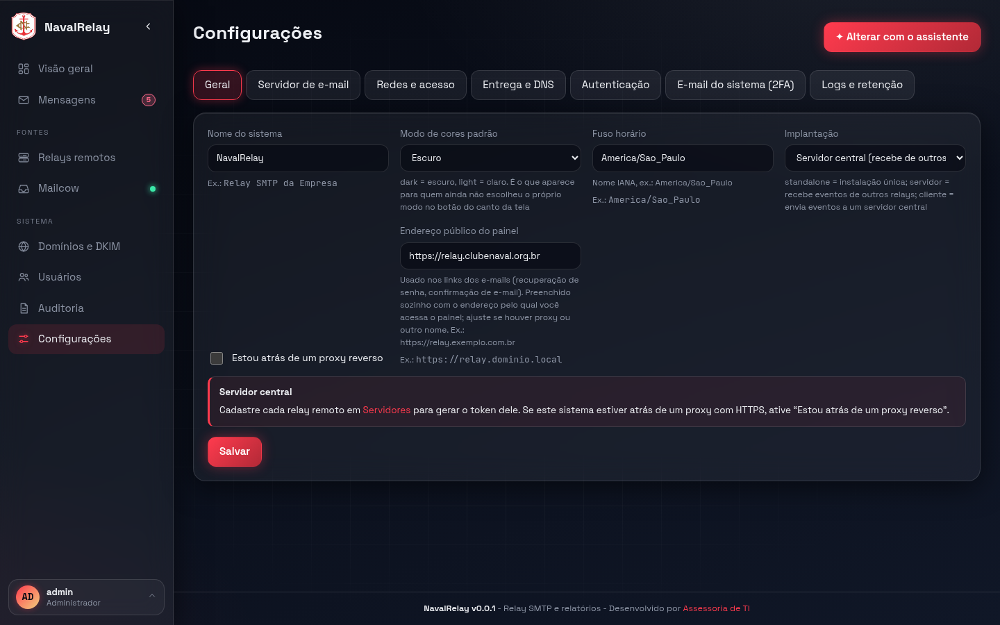
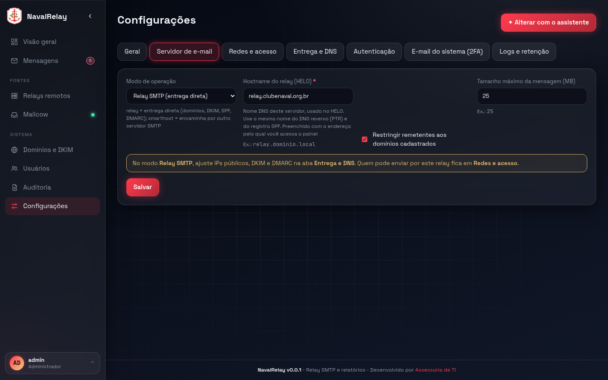
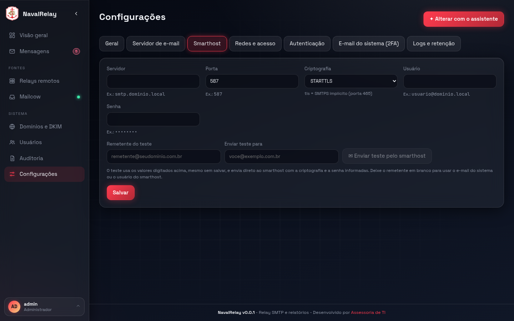
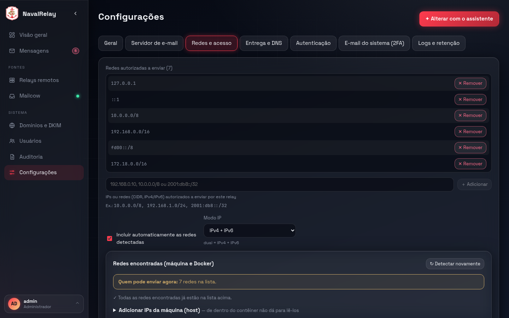
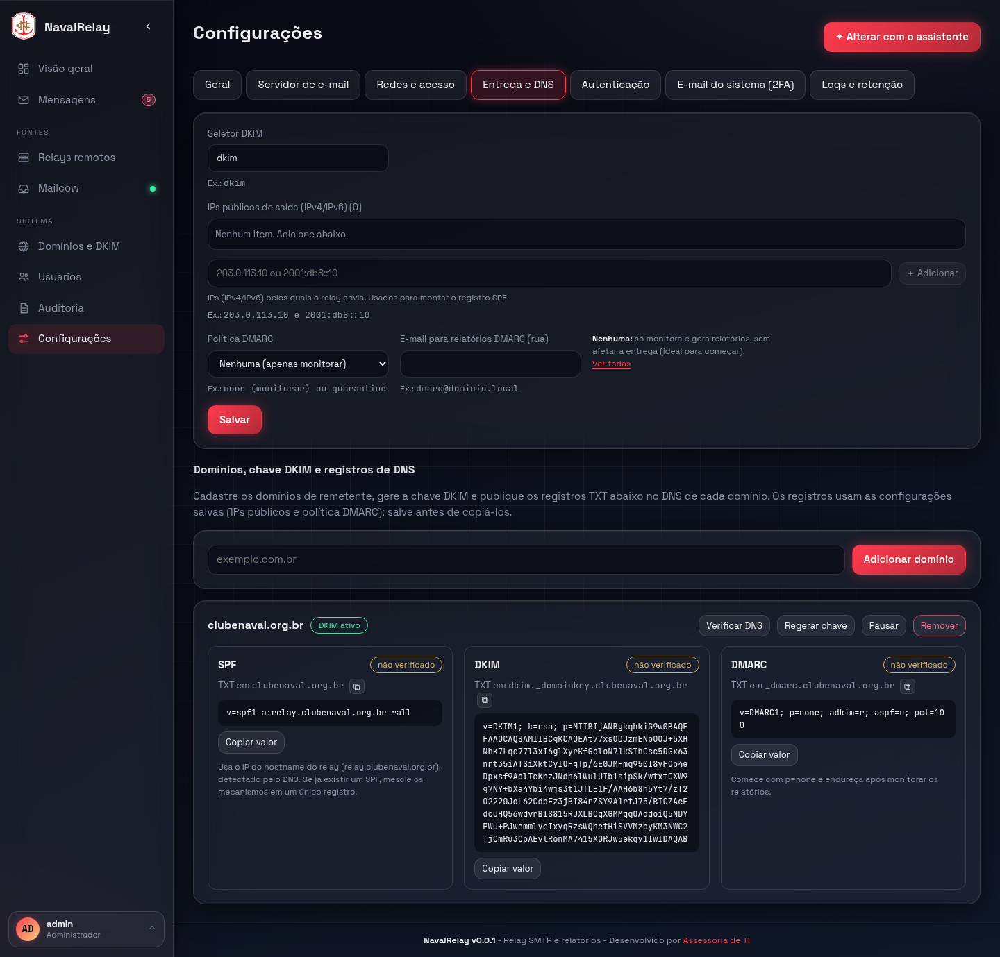
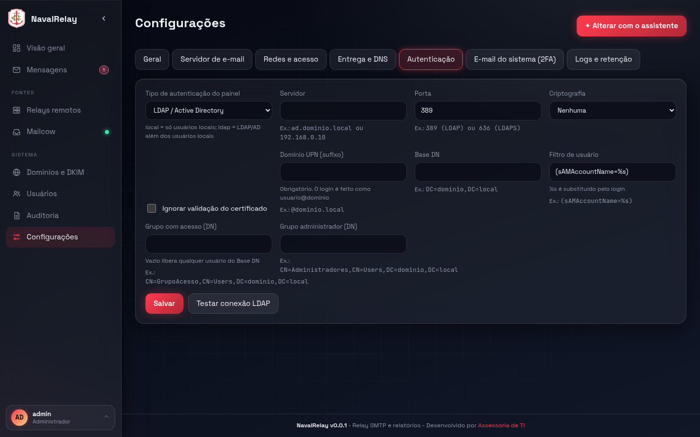
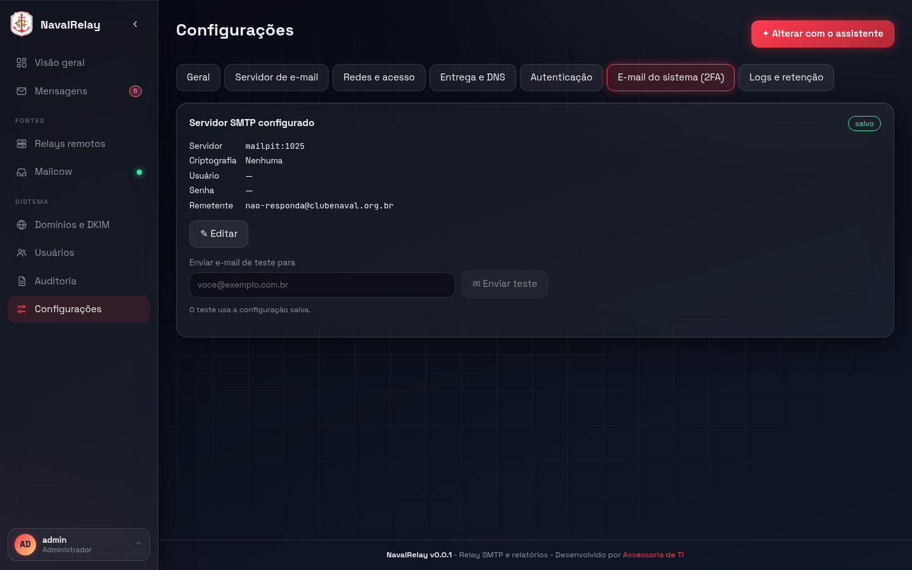
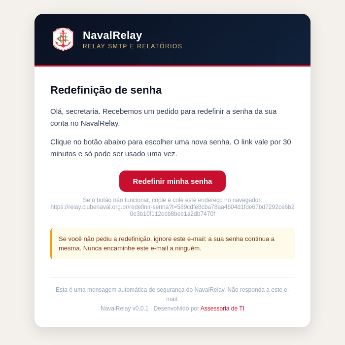
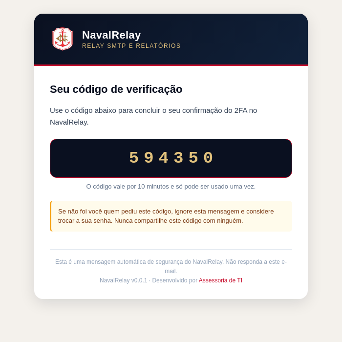

# Configurações

Tudo é configurado em **Configurações**, em abas por finalidade. As abas seguem o modo escolhido na hora, mesmo antes de salvar, e os valores das abas ocultas não são apagados.

| Aba | Conteúdo | Aparece |
|---|---|---|
| [Geral](#geral) | Nome, fuso, implantação, proxy reverso, endereço público, modo de cores | Sempre |
| [Envio para o servidor central](#envio-para-o-servidor-central) | Dados do servidor central | Só no modo Cliente |
| [Servidor de e-mail](#servidor-de-e-mail) | Modo de operação, hostname, tamanho máximo | Sempre |
| [Smarthost](#smarthost) | Servidor, porta, criptografia, usuário e senha, com envio de teste | Só no modo Smarthost |
| [Redes e acesso](#redes-e-acesso) | Redes autorizadas, modo IP, IPv6 | Sempre |
| [Entrega e DNS](#entrega-e-dns) | IPs públicos, DKIM, DMARC e domínios | Só no modo Relay SMTP |
| [Autenticação](#autenticação) | Login local ou LDAP/AD | Sempre |
| [E-mail do sistema (2FA)](#e-mail-do-sistema-2fa) | SMTP usado para códigos e recuperação de senha | Sempre |
| [Logs e retenção](#logs-e-retenção) | Retenção no banco e rotação do log | Sempre |

## Geral

| Campo | Para que serve |
|---|---|
| **Nome do sistema** | Aparece no painel, nas abas do navegador e nos e-mails. |
| **Fuso horário** | Nome IANA, como `America/Sao_Paulo`. Usado nos relatórios. |
| **Implantação** | `standalone`, `server` (central) ou `client`. Veja [Vários servidores](multi-servidor.md). |
| **Estou atrás de um proxy reverso** | Confia em `X-Forwarded-For` e `X-Forwarded-Proto` para identificar o IP real. Ative só se houver um proxy confiável na frente. |
| **Endereço público do painel** | Usado nos links dos e-mails (recuperação de senha e confirmação de e-mail). É preenchido sozinho quando um administrador abre as Configurações pelo endereço real (não `localhost`). Ajuste se houver proxy ou outro nome. |
| **Modo de cores padrão** | Escuro ou claro, para quem ainda não escolheu o próprio modo no botão do menu do usuário. |

## Envio para o servidor central

Só aparece quando a implantação é **Cliente**. Informe protocolo (HTTP ou HTTPS), endereço, porta, caminho base opcional, token e intervalo de envio, e use **Testar conexão**. Detalhes em [Vários servidores](multi-servidor.md).

## Servidor de e-mail

| Campo | Para que serve |
|---|---|
| **Modo de operação** | **Relay SMTP**: entrega direta aos servidores de destino, com domínios, DKIM, SPF e DMARC. **Smarthost**: encaminha tudo por outro servidor SMTP (Gmail, Office 365, SES…). |
| **Hostname do relay (HELO)** | Obrigatório. Nome DNS do servidor, usado no HELO/EHLO. Use o mesmo nome do DNS reverso (PTR) e do registro SPF. Vem preenchido com o endereço pelo qual você acessa o painel. |
| **Tamanho máximo da mensagem (MB)** | Limite de tamanho aceito pelo relay. |
| **Restringir remetentes aos domínios cadastrados** | (Modo Relay) só aceita mensagens cujo remetente seja de um domínio cadastrado. |

## Smarthost

Para o modo Smarthost informe servidor, porta, criptografia (**nenhuma**, **STARTTLS** ou **TLS implícito/SMTPS**), usuário e senha.

Há um **envio de e-mail de teste direto ao smarthost**: informe o remetente e o destino e clique em **Enviar teste pelo smarthost**. O teste usa os valores digitados, mesmo sem salvar, e mostra o resultado na hora, com mensagens claras para servidor inacessível, autenticação recusada ou TLS.

### Smarthost do Google (`smtp-relay.gmail.com`)

- Porta 587 com STARTTLS ou 465 com TLS implícito.
- O remetente precisa ser um endereço que o Google aceite para a sua conta ou domínio.
- O Google exige que o **IP público do servidor** (ou o usuário) esteja autorizado em **Admin do Google Workspace > Apps > Google Workspace > Gmail > Roteamento > Serviço de relay de SMTP**.
- O NavalRelay se apresenta (EHLO) com o **hostname do relay**. O Google fecha a conexão se o EHLO for `localhost`.

## Redes e acesso

Define **quem pode enviar e-mails por este relay**.

| Campo | Para que serve |
|---|---|
| **Redes autorizadas a enviar** | Lista de IPs e redes (CIDR, IPv4 e IPv6). Cada item tem o botão **Remover** e há um campo para adicionar vários de uma vez, com validação. |
| **Incluir automaticamente as redes detectadas** | Soma à lista o loopback, a rede Docker em que o contêiner está (IPv4 e IPv6) e os IPs da máquina conhecidos. |
| **Modo IP** | `dual` (IPv4 e IPv6) ou `ipv4`. |

O painel **Redes encontradas** mostra o resumo "Quem pode enviar agora" e uma lista recolhível de **Outros IPs e redes encontrados** (outras redes Docker, o IP do host em cada rede e os IPs do nome DNS do painel) com **Adicionar todos**. Veja os detalhes e o diagnóstico de IPv6 em [Docker, rede e IPv6](docker-rede-ipv6.md).

> Conexões que chegam pelo gateway do Docker (IP de origem mascarado) são **sempre recusadas**, mesmo dentro de uma rede autorizada. Veja o motivo em [Docker, rede e IPv6](docker-rede-ipv6.md).

## Entrega e DNS

Só no modo Relay SMTP. Configura o SPF, o DKIM e o DMARC e cadastra os domínios. O passo a passo está em [DNS: SPF, DKIM e DMARC](dns-spf-dkim-dmarc.md).

## Autenticação

Escolha **local** (só usuários criados no painel) ou **LDAP / Active Directory** (usuários do diretório, além dos locais). O guia completo está em [LDAP / Active Directory](ldap-ad.md).

## E-mail do sistema (2FA)

SMTP de saída que o sistema usa para enviar **códigos de verificação do 2FA por e-mail**, **recuperação de senha**, **confirmação de troca de e-mail** e e-mails de teste. Pode ser o seu próprio relay (por exemplo `navalrelay-mta`, porta 25, sem criptografia, se a rede Docker estiver nas redes autorizadas) ou qualquer outro servidor SMTP.

| Campo | Para que serve |
|---|---|
| Servidor, porta e criptografia | Dados do SMTP. |
| Usuário e senha (opcional) | Se o servidor exigir autenticação (use STARTTLS ou TLS). |
| Remetente | Endereço que aparece nos e-mails do sistema. |

Depois de salvo, a configuração aparece como um **resumo** (a senha fica criptografada e aparece só como "salva"), com o botão **Editar**. Há um campo para **enviar um e-mail de teste**, que usa os valores digitados mesmo sem salvar.

Os e-mails usam um modelo HTML com o logo e a identidade visual do sistema, mais uma versão em texto simples.

  
  
  

## Logs e retenção

| Campo | Para que serve |
|---|---|
| **Retenção no banco (dias)** | Mensagens mais antigas são apagadas automaticamente (padrão 365). |
| **Rotacionar log do Exim ao atingir (MB)** | Rotação por tamanho, além da diária. |
| **Arquivos de log mantidos em disco** | Quantos arquivos rotacionados são mantidos (compactados). |
| **Ocultar por padrão falhas por caixa inexistente** | Esconde das telas e dos relatórios mensagens que falharam só porque o destinatário não existe. |
| **Ocultar por padrão mensagens rejeitadas pelo Rspamd (Mailcow)** | Esconde as mensagens barradas como spam. |

O Exim grava em `/var/log/exim/main.log` (volume `mta-logs`), com assunto (`+subject`), TLS e confirmação SMTP. O `logrotate` roda no contêiner do MTA, diariamente e por tamanho. O painel lê o log de forma incremental (controla inode e posição, sobrevive à rotação) e grava no MySQL.
