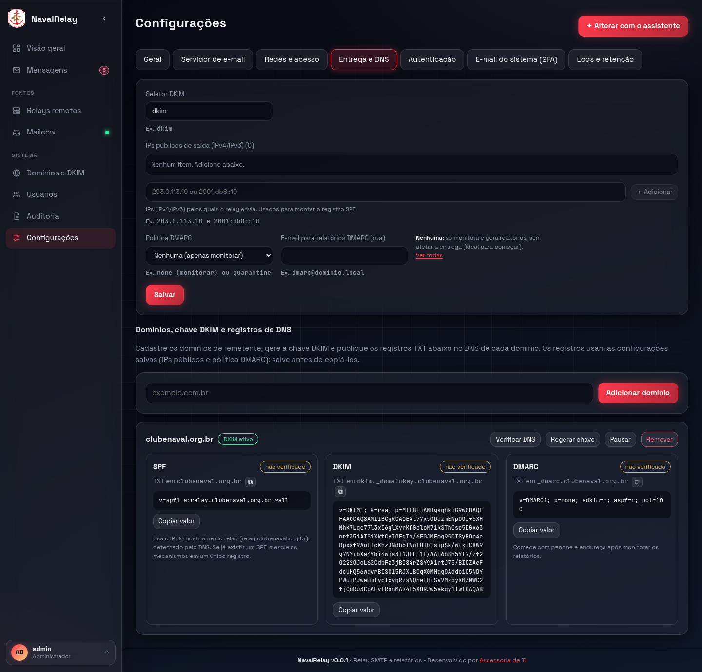

# DNS: SPF, DKIM e DMARC

No modo **Relay SMTP**, o servidor de destino confere se o seu domínio autoriza o seu relay a enviar. Isso é feito por três registros TXT no DNS do domínio. O painel monta os três e verifica se já estão publicados.

| Registro | O que faz |
|---|---|
| **SPF** | Lista quais servidores podem enviar em nome do domínio. |
| **DKIM** | Assina cada mensagem com uma chave; o destino confere a assinatura com a chave pública publicada no DNS. |
| **DMARC** | Diz ao destino o que fazer com mensagens que falham no SPF e no DKIM e para onde enviar relatórios. |

## Passo a passo

1. **Configure os parâmetros** em **Configurações > Entrega e DNS**:
   - **Seletor DKIM** (padrão `dkim`);
   - **IPs públicos de saída** (IPv4 e IPv6 pelos quais o relay envia);
   - **Política DMARC** e **e-mail para relatórios** (rua).
2. **Salve.**
3. **Adicione o domínio** no campo **Adicionar domínio**. A **chave DKIM (RSA 2048) é gerada e ativada na hora**, e os três registros aparecem prontos.
4. **Publique os registros TXT** no DNS do domínio. Cada registro tem um botão para copiar o valor e um botão pequeno (⧉) para copiar o **nome completo** (por exemplo `_dmarc.seudominio.com.br`).
5. Clique em **Verificar DNS**. Cada registro mostra **✓ Registro encontrado no DNS** (no DKIM: "igual à chave gerada") ou, se estiver pendente ou diferente, um recolhível com o que foi encontrado.

## Como cada registro é montado

### SPF

O valor depende do que está configurado, nesta ordem:

1. **IPs públicos de saída** configurados → `v=spf1 ip4:203.0.113.10 ip6:2001:db8:10::10 ~all`.
2. Senão, o **hostname do relay** → `v=spf1 a:relay.exemplo.com.br ~all`.
3. Senão, o **próprio domínio adicionado** → `v=spf1 a:seudominio.com.br ~all`, mostrando os IPs que o DNS devolve e avisando se o domínio não tiver registro A ou AAAA.

> `a:<domínio>` só funciona se esse nome apontar para o servidor que envia. Se você envia por `relay.exemplo.com.br` mas o domínio de e-mail é `empresa.com.br`, preencha o hostname do relay ou os IPs públicos.

Se já existir um SPF no domínio, **mescle** os mecanismos em um único registro (um domínio só pode ter um SPF).

### DKIM

- **Nome**: `seletor._domainkey.seudominio.com.br` (por padrão `dkim._domainkey…`). O nome acompanha o seletor digitado nas configurações; se você alterou e ainda não salvou, o painel avisa.
- **Valor**: `v=DKIM1; k=rsa; p=<chave pública>`.
- A chave privada fica **criptografada** no banco e é entregue ao Exim por um mapa de chaves gerado pelo sistema.
- **Regerar chave** cria uma chave nova (publique o novo valor); **Pausar** desliga a assinatura daquele domínio sem apagar a chave.

### DMARC

- **Nome**: `_dmarc.seudominio.com.br`.
- **Valor**: `v=DMARC1; p=<política>; rua=mailto:<e-mail>; adkim=r; aspf=r; pct=100`.
- **Políticas**:
  - **none**: só monitora; as mensagens que falham continuam sendo entregues. É a opção para começar.
  - **quarantine**: pede ao destinatário que trate as que falham como suspeitas (normalmente spam).
  - **reject**: pede ao destinatário que recuse as que falham. É a mais rígida: use só depois de confirmar que SPF e DKIM estão corretos.

Comece com `none`, acompanhe os relatórios e endureça depois.

## Verificação de DNS

A verificação consulta **resolvedores públicos** (padrão `8.8.8.8` e `1.1.1.1`), porque o DNS interno da empresa pode não ter os registros públicos (*split-horizon*). Para usar outros resolvedores, defina `ORBITA_DNS_SERVERS` no serviço `navalrelay-app` (por exemplo `9.9.9.9,1.1.1.1`). O contêiner precisa de saída UDP para a porta 53.

## Conferindo se as mensagens estão sendo assinadas

Envie um e-mail de teste (Configurações > E-mail do sistema) para uma conta Gmail, abra **Mostrar original** e procure `DKIM: PASS` com `d=seudominio` e `s=dkim`, ao lado de `SPF: PASS` e `DMARC: PASS`.

Se não houver assinatura, veja a [solução de problemas](solucao-de-problemas.md#as-mensagens-saem-sem-assinatura-dkim).

## DNS reverso (PTR)

Para entrega direta, o IP público do servidor deve ter um **PTR** apontando para o hostname do relay, e esse hostname deve resolver de volta para o mesmo IP. Isso é configurado com o provedor do IP, fora do NavalRelay.
