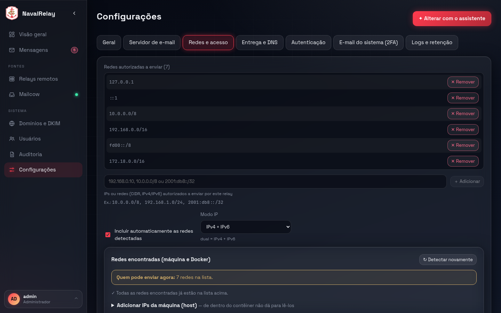

# Docker, rede e IPv6

## Enviando a partir do próprio servidor

**Não use `localhost` nem `127.0.0.1` como servidor SMTP na máquina que roda o Docker.** Use o **endereço IP da própria máquina** (por exemplo `192.168.0.10`) ou o nome DNS dela.

### Por que `localhost` não funciona

Ao acessar a porta publicada por `localhost`, o Docker encaminha a conexão por um intermediário (`docker-proxy`), e o Exim passa a ver a origem como o **gateway da rede do Docker** (por exemplo `172.28.0.1`), e não `127.0.0.1`. Essa aparência é idêntica à de uma conexão externa com o IP mascarado. Por isso o NavalRelay **recusa de propósito**, para nunca virar um *open relay*:

```
550 Connection through Docker gateway refused (source IP masked); connect using the server IP address instead of localhost
```

### Como configurar

Troque `192.168.0.10` pelo IP da máquina. Ele precisa estar em **Redes autorizadas** (o IP da máquina acessada pelo painel já é aprendido, e `192.168.0.0/16`, `10.0.0.0/8` e `fd00::/8` vêm no padrão).

| Cliente | Configuração |
|---|---|
| mutt (`~/.muttrc`) | `set smtp_url="smtp://192.168.0.10:25"` |
| msmtp (`~/.msmtprc`) | `host 192.168.0.10` e `port 25` |
| swaks | `swaks --server 192.168.0.10 --to destino@exemplo.com` |
| PHP (`php.ini`) | `SMTP = 192.168.0.10` e `smtp_port = 25` |
| Aplicações e scripts | servidor `192.168.0.10`, porta `25` (ou `587`) |

Dicas:

- **Fixe o IP da máquina** (DHCP com reserva ou IP estático). Se ele mudar, os envios deixam de funcionar.
- Outros servidores da rede e contêineres de outras stacks usam o mesmo IP e porta, sem restrição.
- O `localhost` não é suportado neste modelo de rede; use sempre o IP ou o nome DNS da máquina.

## Redes autorizadas

A aba **Redes e acesso** define quem pode enviar. Com **Incluir automaticamente as redes detectadas** ligado (padrão), o sistema soma à sua lista:

- o **loopback**;
- a **rede Docker em que o contêiner está** (IPv4 e IPv6), lida das interfaces dele;
- os **IPs da máquina** que ele conhece: o IP pelo qual você acessou o painel e os informados em `ORBITA_HOST_IPS`.

A lista é recalculada ao iniciar e ao salvar.

<p align="center"></p>

- **Dentro do contêiner só é possível ver as interfaces dele.** Para os IPs reais da máquina, rode `hostname -I` no servidor e cole o resultado no campo **IPs da máquina (host)**, ou fixe-os na variável `ORBITA_HOST_IPS` do serviço `navalrelay-app` (aceita IP ou CIDR, separados por vírgula).
- O painel **Redes encontradas** lista, de forma recolhível, outras redes Docker do host, o IP do host em cada rede e os IPs do nome DNS do painel. O botão **Adicionar todos** inclui tudo de uma vez. No **assistente**, as redes encontradas já vêm adicionadas: remova as que não quiser.
- Em **Redes autorizadas a enviar**, cada item tem **Remover**, e há um campo para adicionar manualmente (vários valores por vez, com validação de IPv4, IPv6 e CIDR).

> Revise a lista: ao adicionar outras redes Docker e os IPs do DNS do seu domínio, você autoriza essas origens a enviar e-mails.

## IPv6 no Docker

O contêiner `mta` publica as portas `25` e `587` (IPv4 e IPv6) em uma rede do compose com IPv6 habilitado. Para o IPv6 funcionar com o IP de origem real, o daemon do Docker precisa estar preparado.

Em **Configurações > Redes e acesso** (modo IP "IPv4 + IPv6") e no assistente, o painel **IPv6 no Docker** detecta a versão do Docker, o IPv6 no daemon e no contêiner, a saída IPv6 e se o IP de origem está sendo mascarado. Quando algo falta, ele mostra o passo a passo para a sua versão.

- A versão e o estado do daemon vêm do serviço `navalrelay-proxy` (proxy somente leitura da API do Docker, com acesso apenas a versão, info e redes). Para não usá-lo, remova o serviço e a variável `ORBITA_DOCKER_API` do app; o painel passa a pedir a versão manualmente.
- **Resumo**: Docker 27 ou mais novo, `{"ipv6": true, "ip6tables": true}` em `/etc/docker/daemon.json`; Docker 26 ou mais antigo, o mesmo mais `"experimental": true`. Depois, `sudo systemctl restart docker` e `docker compose up -d --force-recreate`.
- O servidor também precisa de um **endereço IPv6 global** e do encaminhamento ativo (`net.ipv6.conf.all.forwarding=1`).
- **Segurança**: conexões que chegam com o IP do gateway do Docker (origem mascarada) são sempre recusadas, para que uma falha de IPv6 nunca vire *open relay*.
- Sem IPv6 no Docker, o relay continua funcionando normalmente em IPv4 (modo IP "Somente IPv4" em Configurações).
