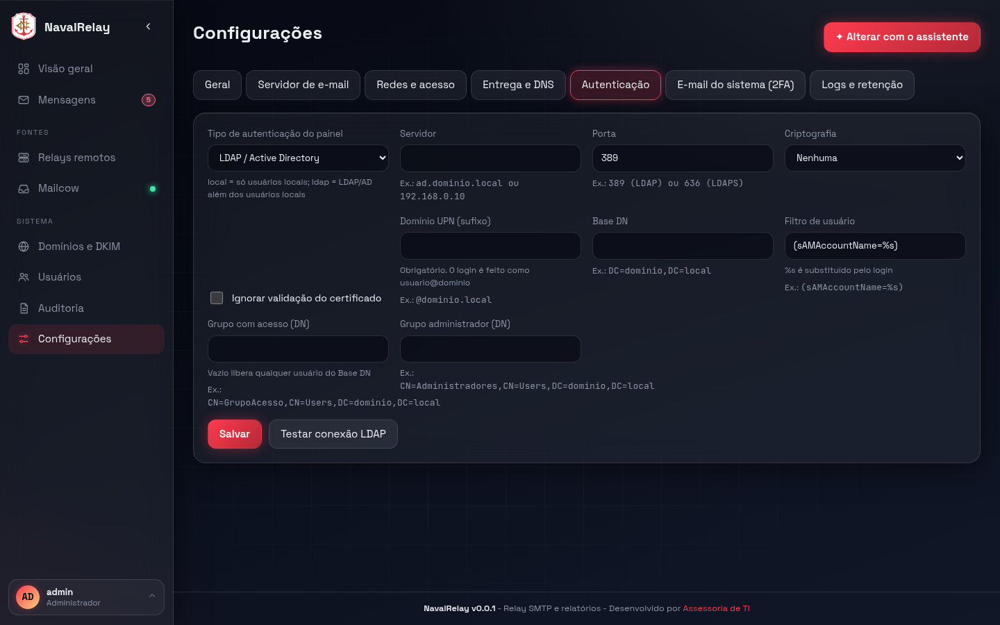
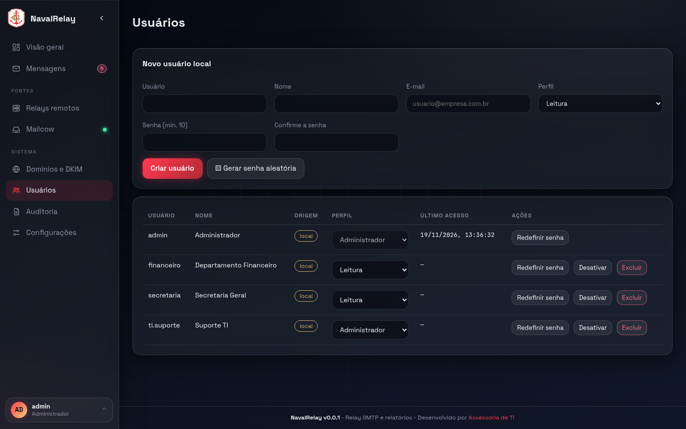

# LDAP / Active Directory

Com o login por **LDAP/Active Directory**, as pessoas entram no painel com a **mesma conta e senha do domínio**. Não é preciso criar usuários à mão, e você decide quem tem acesso e quem é administrador por **grupos do AD**.

<p align="center"> Autenticação" width="850"></p>

## Como funciona

1. A pessoa digita o usuário (por exemplo `joao.santos`) e a senha no login do painel.
2. O NavalRelay faz o **bind no diretório com as credenciais dessa pessoa**, usando o formato UPN: `joao.santos@exemplo.local` (usuário + o **sufixo UPN** configurado). **Não é preciso uma conta de serviço**, e nenhuma senha de diretório fica guardada no sistema.
3. Se o bind funcionar, o sistema procura o usuário na **Base DN**, aplicando o filtro de usuário e, se houver, a restrição do **grupo de acesso**.
4. Se a pessoa estiver no **grupo de administradores**, ela entra como **Administrador**; caso contrário, como **Leitura**.
5. O usuário é criado automaticamente no primeiro login (origem `ldap`), com nome e e-mail vindos do diretório.

Os usuários **locais continuam funcionando** junto com o LDAP. O login tenta primeiro o usuário local; se não houver, consulta o diretório.

> Compatibilidade: a verificação de grupos usa a regra de correspondência do Active Directory (`1.2.840.113556.1.4.1941`), que também resolve **grupos aninhados**. Funciona no **Active Directory** e em compatíveis com essa regra (por exemplo, Samba AD). Em um servidor LDAP genérico (como OpenLDAP) que não tenha essa regra nem o atributo `memberOf`, deixe os grupos vazios; o login por UPN também depende de o servidor aceitar bind nesse formato.

## Antes de começar

Reúna estas informações do seu domínio:

| Informação | Como obter | Exemplo |
|---|---|---|
| **Servidor** (controlador de domínio) | Nome ou IP do DC acessível a partir do servidor do NavalRelay | `dc01.exemplo.local` |
| **Porta** | 389 (LDAP, com ou sem STARTTLS) ou 636 (LDAPS) | `636` |
| **Sufixo UPN** | O que vem depois do `@` no login do usuário. No AD: atributo `userPrincipalName` ou `Get-ADForest \| Select UPNSuffixes` | `@exemplo.local` |
| **Base DN** | Raiz da busca de usuários | `DC=exemplo,DC=local` |
| **DN do grupo de acesso** | (opcional) quem pode entrar | `CN=Relay-Acesso,OU=Grupos,DC=exemplo,DC=local` |
| **DN do grupo de administradores** | (opcional) quem entra como administrador | `CN=Relay-Admins,OU=Grupos,DC=exemplo,DC=local` |

### Como descobrir o DN de um grupo

No PowerShell do controlador de domínio:

```powershell
Get-ADGroup "Relay-Acesso" | Select-Object DistinguishedName
```

Ou, no prompt de comando: `dsquery group -name "Relay-Acesso"`.

Ou, na interface: em **Usuários e Computadores do Active Directory**, ative **Exibir > Recursos Avançados**, abra as propriedades do grupo, aba **Editor de Atributos**, e copie o valor de `distinguishedName`.

### Crie os grupos (recomendado)

Crie dois grupos de segurança no AD, por exemplo `Relay-Acesso` (quem pode ver os relatórios) e `Relay-Admins` (quem administra), e coloque nelas as pessoas ou outros grupos. Como a verificação inclui grupos aninhados, você pode colocar um grupo existente dentro deles.

### Rede

O servidor do NavalRelay precisa alcançar o controlador de domínio na porta escolhida (389 ou 636), e o **nome do servidor precisa resolver dentro do contêiner**. Se o nome do DC for interno, confirme que o DNS usado pelo Docker o resolve (ou use o IP do DC; no LDAPS o certificado precisa corresponder ao nome, veja abaixo).

## Passo a passo

1. Abra **Configurações > Autenticação**.
2. Em **Tipo de autenticação do painel**, escolha **LDAP / Active Directory**.
3. Preencha os campos:

| Campo | O que colocar |
|---|---|
| **Servidor** | `dc01.exemplo.local` |
| **Porta** | `636` (LDAPS) ou `389` (LDAP / STARTTLS) |
| **Criptografia** | `LDAPS` (porta 636), `STARTTLS` (porta 389) ou `Nenhuma` |
| **Ignorar validação do certificado** | Marque só se o certificado do DC for autoassinado e você aceitar o risco |
| **Domínio UPN (sufixo)** | `@exemplo.local` (**obrigatório**, o login é feito como `usuario@dominio`) |
| **Base DN** | `DC=exemplo,DC=local` |
| **Filtro de usuário** | `(sAMAccountName=%s)` (padrão; `%s` é substituído pelo login) |
| **Grupo com acesso (DN)** | `CN=Relay-Acesso,OU=Grupos,DC=exemplo,DC=local`, ou vazio para liberar qualquer usuário da Base DN |
| **Grupo administrador (DN)** | `CN=Relay-Admins,OU=Grupos,DC=exemplo,DC=local`. Os membros entram como administradores, mesmo fora do grupo com acesso |

4. Clique em **Salvar**.
5. Clique em **Testar conexão LDAP**. O teste confirma que o servidor é alcançável e que a criptografia está correta. Ele **não** testa um usuário.
6. **Teste o login de verdade**: abra uma janela anônima, entre com uma conta do AD (por exemplo `joao.santos`) e confira o perfil recebido.

> **Mantenha uma conta local de administrador.** Se o diretório ficar indisponível ou uma configuração estiver errada, você ainda consegue entrar com o administrador local e corrigir.

## Segurança do canal

- Prefira **LDAPS (636)** ou **STARTTLS (389)**. Com `Nenhuma`, a senha trafega **sem criptografia** no bind.
- Com LDAPS ou STARTTLS, o **nome do servidor** configurado precisa constar no certificado do controlador de domínio. Se você usa o IP ou um apelido, a validação falha; use o nome correto do certificado ou, em último caso, marque **Ignorar validação do certificado**.
- O login tem **limite de tentativas** (10 por IP a cada 5 minutos).

## Perfis e permissões

| Situação | Resultado |
|---|---|
| Está no **grupo de administradores** | Entra como **Administrador**. |
| Está no grupo de acesso (ou o grupo de acesso está vazio) e não é administrador | Entra como **Leitura**. |
| Não está no grupo de acesso | O login é recusado. |

Detalhes importantes:

- O papel **Administrador** é aplicado no login. **Remover alguém do grupo de administradores não rebaixa a conta automaticamente**: em **Usuários**, altere o perfil dela para **Leitura** (ou desative-a).
- O **perfil também pode ser alterado manualmente** em **Usuários**. Se a pessoa continuar no grupo de administradores, ela volta a ser administradora no próximo login.
- Para **bloquear** alguém, use **Desativar** em **Usuários** ou tire a pessoa do grupo de acesso.
- **Nome e e-mail** são atualizados a partir do diretório a cada login. O e-mail do diretório é o usado no 2FA por e-mail.
- A **senha é a do diretório**: ela é trocada no AD, não no painel. Por isso, **Minha conta** (troca de senha e de e-mail) não aparece para usuários LDAP.
- O **2FA** funciona para usuários LDAP: eles ativam em **Segurança (2FA)**, por aplicativo ou por e-mail. Veja [Segurança](seguranca.md).
- A **recuperação de senha por e-mail** vale só para usuários locais.

## Filtros de usuário alternativos

O padrão `(sAMAccountName=%s)` funciona quando a pessoa digita o nome de login do Windows. Alguns exemplos:

| Objetivo | Filtro |
|---|---|
| Login pelo nome de logon do Windows (padrão) | `(sAMAccountName=%s)` |
| Login pelo e-mail (atributo `mail`) | `(mail=%s@exemplo.com.br)` |
| Login pelo UPN | `(userPrincipalName=%s@exemplo.local)` |
| Só contas ativas | `(&(sAMAccountName=%s)(!(userAccountControl:1.2.840.113556.1.4.803:=2)))` |

O `%s` é substituído pelo que a pessoa digitou **antes do `@`**, com os caracteres especiais escapados. O bind continua sendo feito pelo UPN (`usuario` + sufixo configurado), então o filtro só escolhe qual entrada do diretório representa o usuário.

## Problemas comuns

Veja o motivo exato nos logs do app:

```bash
docker logs navalrelay-app 2>&1 | grep -i ldap
```

| Sintoma | Causa provável | O que fazer |
|---|---|---|
| "Usuário ou senha inválidos" para uma conta correta | Sufixo UPN errado ou vazio | Confira o **Domínio UPN** (`@exemplo.local`). Use o valor do atributo `userPrincipalName` do usuário. |
| Log: `informe o domínio UPN nas configurações` | **Domínio UPN** vazio | Preencha o campo. |
| Log: `LDAP não configurado` | Servidor ou porta vazios | Preencha servidor e porta. |
| **Testar conexão** falha | DC inacessível, porta bloqueada, nome não resolve, certificado inválido | Teste de dentro do contêiner: `docker exec navalrelay-app nslookup dc01.exemplo.local` (DNS) e `docker exec navalrelay-app nc -w 3 dc01.exemplo.local 636 < /dev/null && echo aberta` (porta). Confira firewall, DNS e certificado. |
| O teste passa, mas o login falha | Filtro, Base DN ou grupo de acesso não incluem o usuário | Confira o **Base DN**, o **filtro** e se a pessoa está no **grupo de acesso** (inclusive por grupos aninhados). |
| Entra como Leitura, mas deveria ser administrador | Não está no grupo de administradores, ou o DN do grupo está errado | Confira o DN exato do grupo (veja "Como descobrir o DN"). |
| Falha só com LDAPS | Certificado não corresponde ao nome do servidor | Use o nome presente no certificado, ou marque **Ignorar validação do certificado**. |

## Exemplo completo

| Campo | Valor |
|---|---|
| Tipo de autenticação | LDAP / Active Directory |
| Servidor | `dc01.exemplo.local` |
| Porta | `636` |
| Criptografia | `LDAPS` |
| Domínio UPN (sufixo) | `@exemplo.local` |
| Base DN | `DC=exemplo,DC=local` |
| Filtro de usuário | `(sAMAccountName=%s)` |
| Grupo com acesso (DN) | `CN=Relay-Acesso,OU=Grupos,DC=exemplo,DC=local` |
| Grupo administrador (DN) | `CN=Relay-Admins,OU=Grupos,DC=exemplo,DC=local` |

Com essa configuração, `joao.santos` (membro de `Relay-Admins`) entra como **Administrador** e `ana.souza` (membro de `Relay-Acesso`) entra como **Leitura**, ambos com a senha do domínio.

<p align="center"></p>
