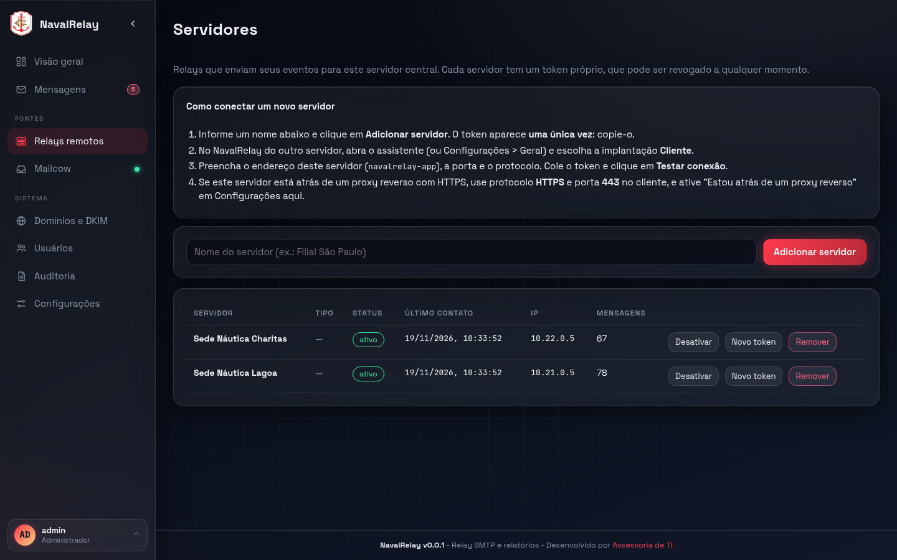

# Vários servidores (central e clientes)

Em **Configurações > Geral** (ou no assistente), escolha a **implantação**:

| Modo | Para que serve |
|---|---|
| **Standalone** | Instalação única. Os relatórios mostram apenas este relay. |
| **Servidor central** | Recebe os eventos de outros relays e unifica os relatórios, com filtro por servidor. |
| **Cliente** | Envia os eventos deste relay a um servidor central (modo *push*; só precisa de conexão de saída). |

Cada instalação continua completa, com banco e painel próprios.

<p align="center"></p>

## Configurando o servidor central

1. Em **Configurações > Geral**, escolha a implantação **Servidor central**. O menu ganha **Relays remotos** (em **Fontes**).
2. Em **Relays remotos**, adicione um servidor para cada relay remoto e **copie o token** gerado. Ele é exibido **uma única vez**; se perder, gere um novo (o antigo deixa de funcionar).
3. Os clientes precisam alcançar a porta do painel, diretamente ou por um proxy reverso.
4. Se houver um **proxy reverso com HTTPS** na frente, mantenha o painel em HTTP interno e ative **Estou atrás de um proxy reverso**, para registrar o IP real do cliente.

Dashboard, mensagens, PDF e CSV ganham o filtro por servidor. Remover um servidor apaga também as mensagens recebidas dele.

## Configurando um cliente

1. Em **Configurações > Geral**, escolha a implantação **Cliente**.
2. Na aba **Envio para o servidor central**, informe:

| Campo | O que colocar |
|---|---|
| **Protocolo** | `HTTPS` (recomendado) ou `HTTP` (o token trafega sem criptografia) |
| **Endereço do servidor central** | O nome DNS ou IP do central |
| **Porta** | `443` para HTTPS ou `80` para HTTP, ou a porta do seu proxy |
| **Caminho base** | Só se o proxy publicar o sistema em um subcaminho |
| **Token do servidor** | O token gerado no central |
| **Ignorar validação do certificado** | Só para certificado autoassinado |
| **Intervalo de envio** | Em segundos (padrão 10) |

3. Clique em **Testar conexão** e salve.

## Como funciona

- O cliente lê o log do Exim com um cursor próprio e envia lotes compactados (JSON com gzip) por `POST /api/collect`, com `Authorization: Bearer <token>`.
- O central valida o token, os tipos e os limites (até 5.000 eventos e 8 MB por lote) e **não duplica** eventos já recebidos.
- Se o central ficar fora do ar, o cliente **retoma do ponto em que parou**, sem perdas.
- Tentativas com token inválido são limitadas (10 a cada 5 minutos por IP).

## Atrás de proxy reverso com HTTPS

O central continua em HTTP interno. No cliente use HTTPS na porta 443 (e o caminho base, se houver). No central ative **Estou atrás de um proxy reverso**. Exemplo de proxy (nginx):

```nginx
location / {
    proxy_pass http://navalrelay-app:8080;
    proxy_set_header Host $host;
    proxy_set_header X-Forwarded-For $proxy_add_x_forwarded_for;
    proxy_set_header X-Forwarded-Proto $scheme;
    client_max_body_size 16m;
}
```
