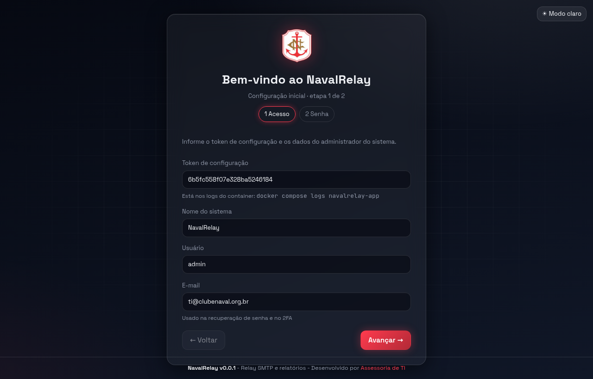
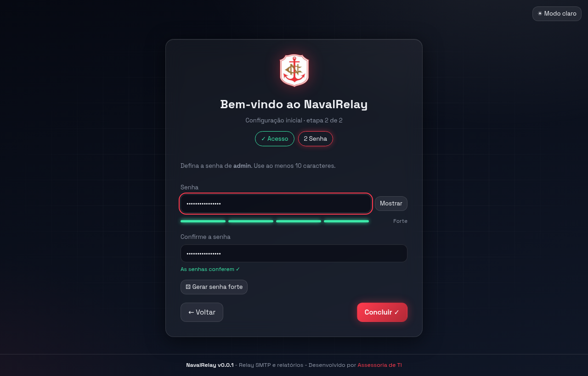
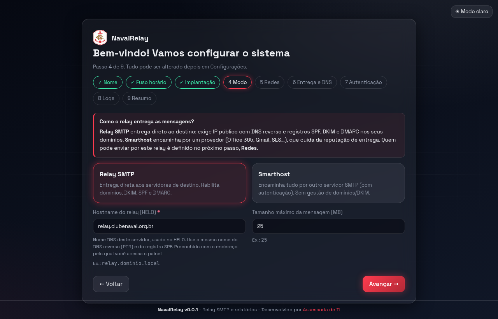
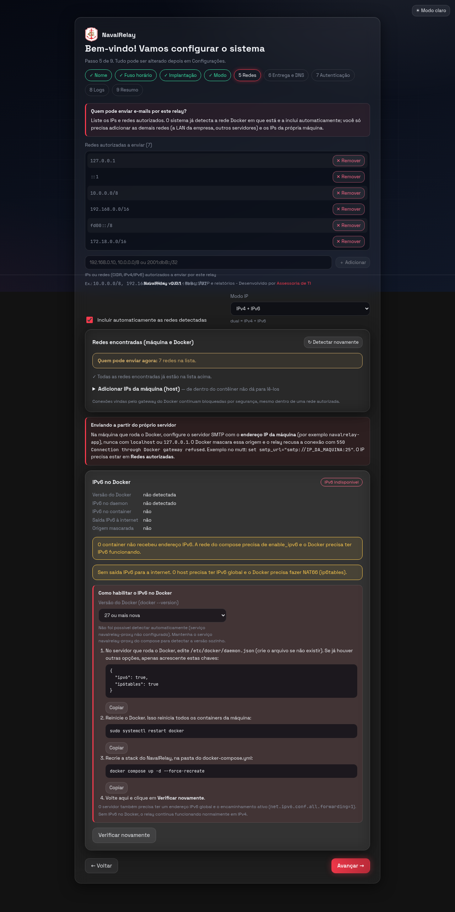
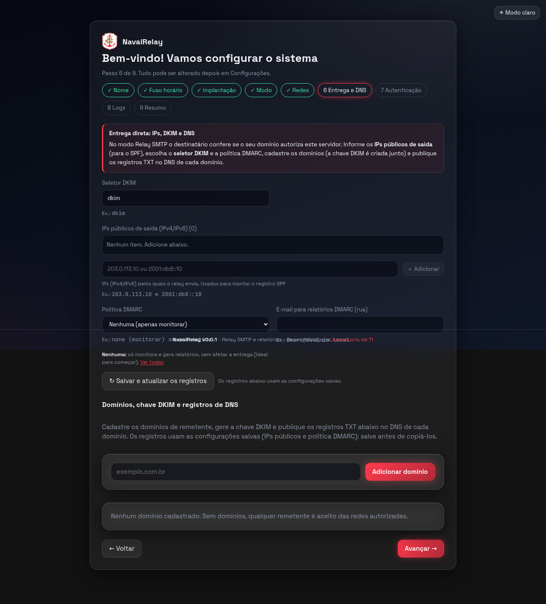

# Primeiro acesso e assistente

## Primeiro acesso

Depois de subir os contêineres, abra `http://IP-DO-SERVIDOR:8080`. O primeiro acesso é feito em etapas.

  
  

1. **Acesso**: informe o **token de configuração** (está nos logs do contêiner: `docker compose logs navalrelay-app | grep TOKEN`), o **nome do sistema**, o **usuário** e o **e-mail** do administrador. O e-mail é obrigatório porque é usado na recuperação de senha e no 2FA. O token é conferido ao avançar.
2. **Senha**: defina a senha e confirme. Há um medidor de força e o botão **Gerar senha forte** (16 caracteres, só letras e números, com botão para copiar). Use ao menos 10 caracteres.

Se o MySQL não estiver configurado pelo compose, há antes uma etapa de **Banco de dados**, com host, porta, usuário, senha, banco e modo SSL, que é testada antes de seguir.

Ao concluir, o administrador é criado e o assistente de configuração abre.

## Assistente de configuração

O assistente guia as configurações essenciais. Tudo pode ser alterado depois em **Configurações**, e ele pode ser reaberto pelo botão **Alterar com o assistente**.

| Passo | O que você define |
|---|---|
| **Nome** | Nome do sistema, que aparece no painel e nos e-mails. |
| **Fuso horário** | Usado nos relatórios e nas datas. |
| **Implantação** | **Standalone** (instalação única), **Servidor central** (recebe eventos de outros relays) ou **Cliente** (envia os eventos a um central). Veja [Vários servidores](multi-servidor.md). |
| **Modo** | **Relay SMTP** (entrega direta) ou **Smarthost** (encaminha por um provedor), hostname do relay (HELO, obrigatório) e tamanho máximo da mensagem. |
| **Redes** | Quem pode enviar e-mails por este relay. As redes encontradas já vêm adicionadas. |
| **Entrega e DNS** | (Só no modo Relay) seletor DKIM, IPs públicos de saída, política DMARC, cadastro de domínios com a chave DKIM e os registros de DNS. |
| **Autenticação** | Login local ou LDAP/AD. Veja [LDAP / Active Directory](ldap-ad.md). |
| **Logs** | Retenção no banco e rotação do log do Exim. |
| **Resumo** | Revisão antes de aplicar. |

  
  
  

### Dicas para o passo Modo

- **Hostname do relay (HELO)** é obrigatório e vem preenchido com o endereço pelo qual você acessou o painel. Use o mesmo nome do **DNS reverso (PTR)** do IP e do registro SPF.
- **Relay SMTP** entrega direto ao destino e exige IP público com DNS reverso e registros SPF, DKIM e DMARC nos seus domínios. **Smarthost** encaminha por um provedor, que cuida da reputação de entrega.

### Dicas para o passo Redes

O sistema detecta a rede Docker em que está e a inclui. Ao chegar neste passo, **todas as redes encontradas** (outras redes Docker, o IP do host em cada rede e os IPs do nome DNS do painel) já são adicionadas à lista. **Revise e remova** o que não quiser. Para os IPs reais da máquina, rode `hostname -I` no servidor e cole o resultado no campo **IPs da máquina (host)**.

## Depois do assistente

1. Aponte suas aplicações para o SMTP do relay (veja [Docker, rede e IPv6](docker-rede-ipv6.md#enviando-a-partir-do-próprio-servidor)).
2. Publique os registros de DNS e use **Verificar DNS** ([DNS: SPF, DKIM e DMARC](dns-spf-dkim-dmarc.md)).
3. Ative o [2FA](seguranca.md#autenticação-em-dois-fatores-2fa) na sua conta.
4. Configure o **E-mail do sistema** (Configurações > E-mail do sistema) para habilitar a recuperação de senha e o 2FA por e-mail.
